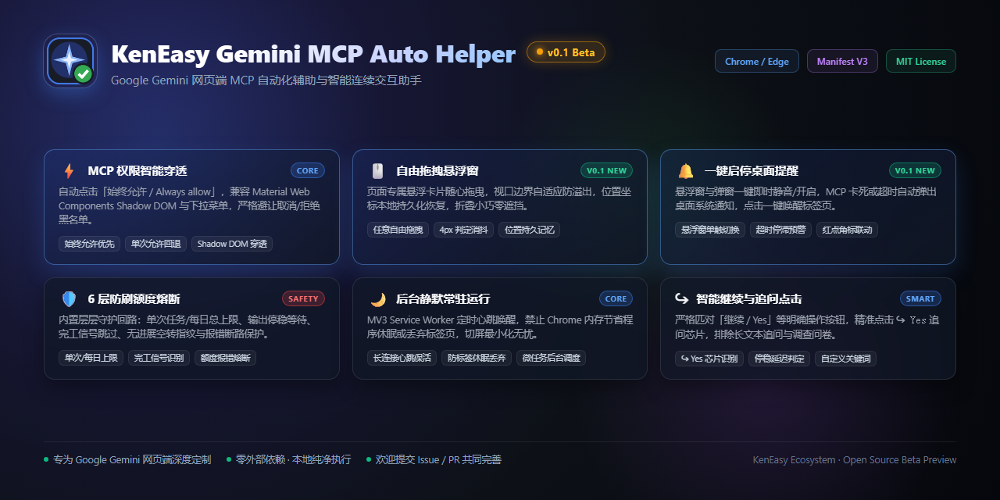
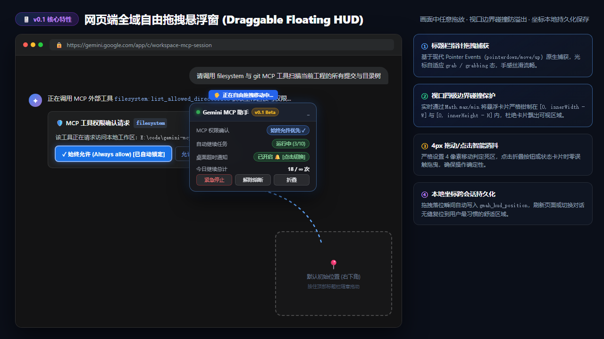
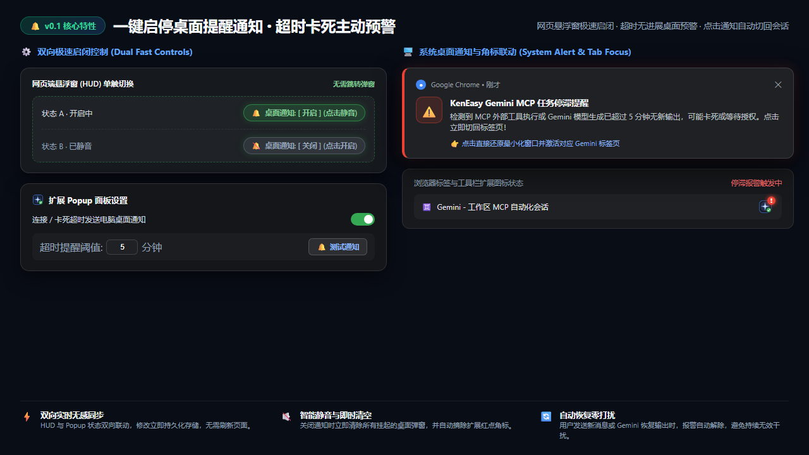
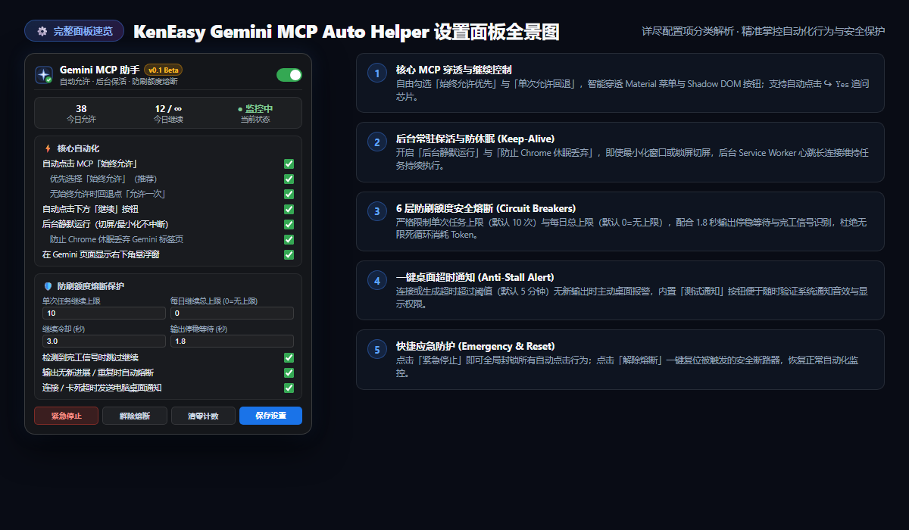

<div align="center">
  

  <h1>KenEasy Gemini MCP Auto Helper</h1>

  <p>
    An intelligent automation extension tailored for <b>Google Gemini</b> web UI: auto-approves MCP tool permissions with "Always allow", auto-clicks "Continue / Yes" follow-up chips, features a freely draggable floating HUD and one-click desktop notifications, with background keep-alive and a 6-layer anti-loop circuit breaker.
  </p>

  <p>
    English · <a href="README.zh-CN.md">简体中文</a>
    ·
    <a href="#-changelog">Changelog</a>
    ·
    <a href="https://github.com/ngiken/KenEasy-Gemini-MCP-Auto-Helper/issues">Issues / Feedback</a>
  </p>

  <p>
    
    
    
    
  </p>
</div>

> [!WARNING]
> ### ⚠️ Beta Release Notice (v0.1 Beta Preview)
> This extension is currently in **Public Beta Preview (v0.1 Beta)**.
> While the core automation engine, 6-layer circuit breaker, draggable HUD, and desktop notification subsystems have passed 100% of the automated test suites, Google Gemini (`gemini.google.com`) continuously updates its Material Web Components and DOM layouts.
> - If you encounter unrecognized confirmation dialogs or unexpected behavior, please submit feedback or screenshots on [GitHub Issues](https://github.com/ngiken/KenEasy-Gemini-MCP-Auto-Helper/issues), or add custom terms in the "Custom Keywords" section of the popup settings.
> - Star 🌟 and PR contributions are warmly welcomed!

---

## 🚀 Installation

### Option 1: Chrome Web Store (Pending Review)

The extension has been submitted for Chrome Web Store security review. Once approved, you can install and receive silent auto-updates with one click:

👉 **[Get KenEasy Gemini MCP Auto Helper on Chrome Web Store (Coming Soon)](https://chromewebstore.google.com/)**

### Option 2: Manual Installation (Developer Mode - Recommended)

To run the latest development build or use the extension offline immediately:

1. Download the latest source package from the [GitHub Releases](https://github.com/ngiken/KenEasy-Gemini-MCP-Auto-Helper/releases) page (or clone the repository using `git clone`).
2. Extract the downloaded zip file into your desired local directory (e.g. `E:\code\gemini-mcp-auto-helper`).
3. Open Google Chrome or Microsoft Edge and navigate to:
   - **Chrome**: `chrome://extensions/`
   - **Edge**: `edge://extensions/`
4. Enable the **Developer mode** toggle in the top-right corner.
5. Click the **Load unpacked** button in the top-left toolbar.
6. In the folder picker dialog, select the repository root directory containing `manifest.json`.
7. Open or refresh [Google Gemini](https://gemini.google.com/). You will see the floating HUD on the page, and clicking the extension toolbar icon opens the full configuration panel.

---

## 🎬 Core Features Walkthrough & Demos (v0.1 Highlights)

### 1. Freely Draggable Floating HUD Anywhere on Screen 🆕
> No longer stuck in the bottom-right corner! Click and drag the HUD header to position it anywhere within the Gemini web interface. Features native Pointer Events tracking, automatic viewport boundary clamping, 4px click-versus-drag disambiguation, and coordinate persistence across page refreshes via LocalStorage.

<div align="center">
  
</div>

### 2. One-Click Desktop Notification & Anti-Stall Alert 🆕
> If an MCP tool execution hangs or model output stalls longer than the configured threshold (default 5 minutes), the extension triggers a native OS desktop notification and flags a red `!` badge on the toolbar icon. Easily mute or enable with a single click directly from the on-page HUD or the popup. Clicking the notification instantly brings the Gemini tab and window back to the foreground.

<div align="center">
  
</div>

### 3. Full Configuration & Control Panel (Popup Overview)
> A comprehensive, decoupled control center: view live statistics for daily automated actions, customize "Always allow" priority and single-allow fallback, calibrate the 6-layer circuit breakers, trigger instant notification tests, and activate the emergency kill switch.

<div align="center">
  
</div>

---

## ⚡ Capability Matrix

| Category | Feature | Technical Breakdown |
| :--- | :--- | :--- |
| **MCP Auto-Approval** | Always Allow Priority | Prefers and auto-clicks `Always allow / 始终允许`, penetrating Material Web Components `<slot>` projections and `role="menu"` / `role="menuitem"` dropdown options. |
| **Single Allow Fallback** | Safe Single Click | Optional fallback to click `Allow once / 仅允许一次` when no "Always allow" option exists, strictly guarded by sibling context checks. |
| **Smart Continuity** | Follow-up Chip Click | Detects and triggers explicit affirmative `↪ Yes` follow-up chips and "Continue" buttons, strictly ignoring general suggestions, surveys, and chat history. |
| **Draggable Floating HUD** 🆕 | Free Movement & Memory | In-page HUD can be dragged anywhere using Pointer Events, constrained by viewport boundary clamping with persistent LocalStorage coordinates. |
| **Desktop Notifications** 🆕 | One-Click Anti-Stall Alert | Issues desktop notifications when MCP execution exceeds the stall threshold (1–60 mins); togglable instantly from either the HUD or the popup. |
| **Background Persistence** | Uninterrupted Execution | MV3 Service Worker keeps Gemini active in minimized or background tabs via long-lived connection ports and `chrome.alarms` heartbeats. |
| **Tab Discard Protection** | Anti-Memory-Saver Sleep | Sets `autoDiscardable: false` on active Gemini tabs to prevent Chrome Memory Saver from unloading the page. |
| **6-Layer Circuit Breaker** | Anti-Loop Quota Guard | Enforces per-task limits, daily limits, streaming stabilization settle time, operation cooldown, completion cues, and stagnant output detection. |
| **Custom Keywords** | Flexible Word Matching | Extend built-in dictionaries with customized comma- or newline-separated keyword phrases for approval and continuation. |
| **Emergency Kill Switch** | Instant Safe Brake | Prominent "Emergency Stop" button instantly blocks all automation actions; includes "Reset Breaker" and "Reset Stats" controls. |

---

## 🛡️ 6-Layer Anti-Loop Circuit Breaker Architecture

To safeguard your API quotas and tokens against runaway recursive loops, the extension implements a comprehensive multi-tier circuit breaker:

```text
               ┌────────────────────────────────────────────────────────┐
               │           Gemini Output & DOM Mutation Stream          │
               └──────────────────────────┬─────────────────────────────┘
                                          │
                  ▼ Layer A: Quota & Error Breaker (Immediate Trip)
          [ "Reached your limit" / "Quota exceeded" / "Try again later" ] ──► 🚨 Hard Stop
                                          │
                  ▼ Layer B: Streaming Settle Guard (Wait for Completion)
               [ Observe DOM until stable with no cursor for >= 1.8s ]
                                          │
                  ▼ Layer C: Operation Cooldown Guard (Rate Limiting)
              [ Force minimum 3.0s delay after every "Continue" action ]
                                          │
                  ▼ Layer D: Per-Task Continue Limit (Single Prompt Guard)
               [ Max continues reached (default 10) ] ──► 🛑 Per-Task Trip
                                          │
                  ▼ Layer E: Daily Continue Cap (All-Day Safety Net)
               [ Daily cap reached (default 0=unlimited) ] ──► 🛑 Daily Trip
                                          │
                  ▼ Layer F: Completion Cue & Smart Pass-Through
            [ "Task completed" found & no explicit ↪ Yes chip ] ──► ⏹️ Skip Action
                                          │
                  ▼ Layer G: Stagnant Output & Repetition Detection
           [ Output DOM unchanged or identical text across turns ] ──► ⚠️ Stagnant Trip
```

1. **Layer A · Quota & Error Cutoff**: Instantly halts all automated actions when Gemini outputs error phrases such as `reached your limit`, `quota exceeded`, `please try again later`, or system service errors.
2. **Layer B · Streaming Settle Guard (default 1.8s)**: Observes streaming output to verify the blinking cursor is gone and no DOM updates have occurred for at least 1.8 seconds before taking any action.
3. **Layer C · Operation Cooldown (default 3.0s)**: Enforces an intentional pause between consecutive clicks to prevent double-click race conditions.
4. **Layer D · Per-Task Limit (default 10)**: Limits continues per conversation turn; automatically resets to 0 whenever the user sends a new prompt.
5. **Layer E · Daily Continue Cap (default 0 = unlimited)**: Caps total automated continues per calendar day, automatically resetting at midnight (00:00).
6. **Layer F · Completion Cue Detection**: Skips auto-continue when Gemini outputs definitive completion phrases like "All tasks finished", while smartly continuing if Gemini explicitly displays a `↪ Yes` follow-up chip.
7. **Layer G · Stagnant Output Fingerprinting**: Trips when consecutive actions produce zero new content or generate identical response hashes, preventing repetitive bot loops.

---

## 🏗️ Architecture & Decoupled Modules

The extension follows clean separation of concerns and data-driven principles:

```text
manifest.json
  Manifest V3 declaration specifying minimal permissions (storage, tabs, alarms, scripting, notifications) and Gemini matching rules.

defaults.js
  Shared configuration hub: built-in keyword dictionaries, default options, schema migration, and boundary clamping.

hud.js & hud.css
  In-page floating HUD component: pointer drag handling, boundary clamping, live state pills, and quick notification toggle.

content.js
  Runs in the isolated content script world: DOM observers, button matching heuristics, circuit breakers, and microtask dispatchers.

background.js
  Persistent Service Worker: manages long-lived ports, heartbeat alarms, tab discard prevention, and OS desktop notifications.

popup.js, popup.html, popup.css
  Extension popup control center: real-time metrics, interactive switches, custom keywords textarea, and emergency controls.
```

---

## ❓ Frequently Asked Questions (FAQ)

<details>
<summary><b>Q1: Why is the floating HUD not appearing on the Gemini page?</b></summary>

1. Confirm that your browser is on a page matching `https://gemini.google.com/*`.
2. Click the extension toolbar icon and ensure that the Master Switch and "Show floating HUD" options are enabled.
3. If the HUD was previously dragged off-screen, click "Save Settings" in the popup to re-clamp it to the visible viewport.
</details>

<details>
<summary><b>Q2: Does the draggable HUD remember its position after refreshing the page?</b></summary>

Yes. When you release the HUD after dragging, its `(left, top)` coordinates are immediately saved to LocalStorage (`gmah_hud_position`). It will restore to your chosen location across page reloads and new chat sessions.
</details>

<details>
<summary><b>Q3: Why did I not receive a desktop notification when execution stalled?</b></summary>

1. Open the popup and click the **"Test Notification"** button to confirm that your browser and operating system have notification permissions enabled.
2. Check if Windows "Focus Assist" or macOS "Do Not Disturb" is active.
3. Verify that the "Desktop Notification" pill in the HUD or the toggle in the popup is turned on.
</details>

<details>
<summary><b>Q4: Will the extension accidentally click "Delete Chat" or "Deny"?</b></summary>

No. The engine applies an explicit exclusion blacklist (blocking terms like delete, remove, deny, cancel, dismiss, survey) combined with strict sibling hierarchy and container verification.
</details>

<details>
<summary><b>Q5: How do I restore default settings?</b></summary>

Click the **"Restore Defaults"** button at the bottom of the extension popup. This resets all thresholds, cooldowns, and keyword sets to safe official defaults.
</details>

---

## Friendly Links

- [LINUX DO](https://linux.do) - Sincere, friendly, collaborative, and professional developer community.

---

## License

This project is licensed under the [MIT License](LICENSE).
