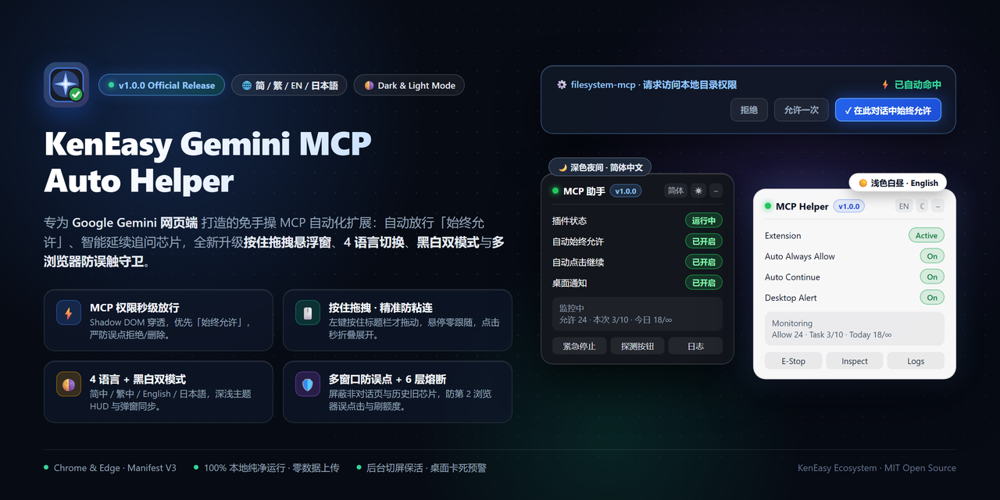
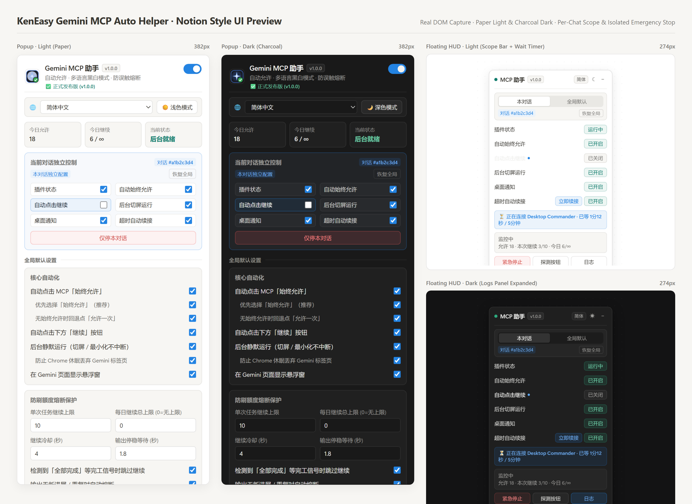
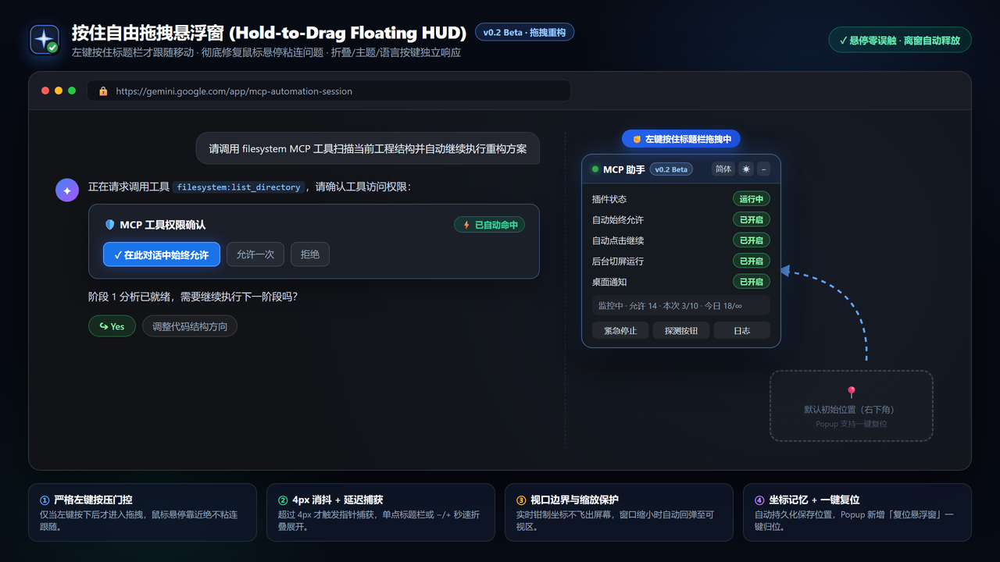
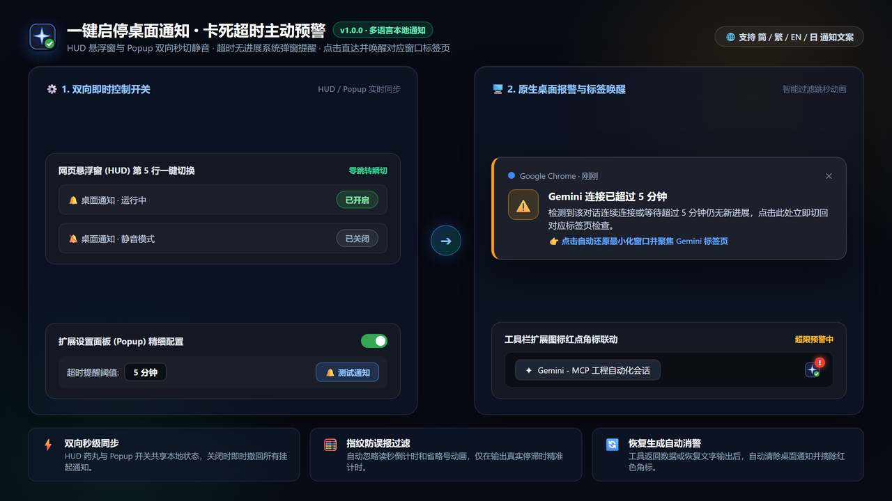
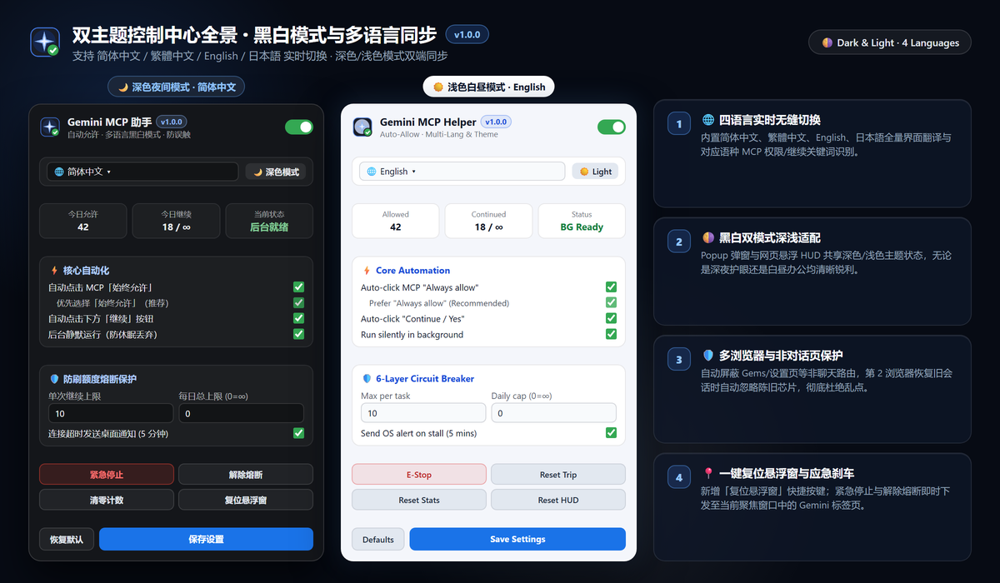

<div align="center">
  

  <h1>KenEasy Gemini MCP Auto Helper</h1>

  <p>
    专为 <b>Google Gemini</b> 网页端打造的 MCP 工具自动化放行与连续对话扩展：全新支持<b>默认模型锁定与全尺寸自动切换守护（偏离自动切回、不可用或反复被切回时立即报错停止）</b>、<b>Notion 风格极简 UI（浅色纸感 / 深色炭灰）</b>、<b>单对话独立开关与隔离紧急停止</b>，自动点击「始终允许」权限与「继续 / Yes」追问芯片，配备<b>后台 / 最小化 / 熄屏 MAIN 世界点击升级、连接卡死实时计时、超时自动终止并自定义续接（默认「继续，刚才mcp连接断开了」）、一键立即续接、拟人防降速节流</b>及<b>MV3 永不断线后台保活引擎</b>，支持<b>简体中文 / 繁體中文 / English / 日本語</b>四语言实时切换、零飞角按住拖拽悬浮窗、超时桌面通知及 6 层防刷额度熔断保护。
  </p>

  <p>
    简体中文 · <a href="README.md">English</a>
    ·
    <a href="CHANGELOG.md">更新记录</a>
    ·
    <a href="https://github.com/ngiken/KenEasy-Gemini-MCP-Auto-Helper/issues">问题反馈</a>
  </p>

  <p>
    
    
    
    
  </p>
</div>

> [!NOTE]
> ### ✅ v2.2 正式发布版
> **KenEasy Gemini MCP Auto Helper v2.2** 现已正式发布！
> 全新推出**默认模型锁定与全尺寸自动切换守护**（支持桌面宽屏、分屏、窄屏移动端、高缩放比例与后台最小化，检测到模型偏离自动切回默认模型，目标模型不可用或反复被切回时立即报错停止并弹出 `ERR` 桌面通知），叠加 Notion 极简双主题 UI、单对话独立开关与隔离急停、后台 / 最小化 / 熄屏 MAIN 世界点击升级、超时自动续接、拟人防降速节流与 6 层防刷熔断器，全部 **129/129** 项自动化与端到端测试全通过。
> - 可在悬浮窗或设置弹窗中一键设置/探测默认模型、自定义续接话术或关键词，欢迎前往 [GitHub Issues](https://github.com/ngiken/KenEasy-Gemini-MCP-Auto-Helper/issues) 反馈。
> - 欢迎各位开发者 Star 🌟 与提交 PR，共同完善 Gemini 网页端自动化生态！

---

## 🚀 安装方式

### 方式一：Chrome 官方应用商店安装（审核中）

已提交至 Chrome Web Store 官方应用商店进行安全审查，上架后支持一键点击安装与全自动静默升级：

👉 **[前往 Chrome Web Store 官方商店安装 KenEasy Gemini MCP Auto Helper（审核中敬请期待）](https://chromewebstore.google.com/)**

### 方式二：本地开发者模式手动安装（推荐 · 一键直接下载）

直接点击下方任意一个下载链接即可**一键自动下载 `.zip` 安装包**：

- 📦 **[点击直接下载：手动安装完整包 (`KenEasy-Gemini-MCP-Auto-Helper-v2.2-manual-install.zip`)](https://github.com/ngiken/KenEasy-Gemini-MCP-Auto-Helper/releases/download/v2.2/KenEasy-Gemini-MCP-Auto-Helper-v2.2-manual-install.zip)**（推荐，解压后含 `KenEasy-Gemini-MCP-Auto-Helper` 文件夹及说明文档）
- 🏪 **[点击直接下载：纯净扩展包 (`KenEasy-Gemini-MCP-Auto-Helper-v2.2-store.zip`)](https://github.com/ngiken/KenEasy-Gemini-MCP-Auto-Helper/releases/download/v2.2/KenEasy-Gemini-MCP-Auto-Helper-v2.2-store.zip)**（解压即根目录 `manifest.json`）

安装步骤：
1. 点击上方链接下载 `.zip` 压缩包并解压到本地目录（例如 `E:\code\KenEasy-Gemini-MCP-Auto-Helper`）。
2. 打开 Chrome 或 Edge 浏览器，在地址栏输入：
   - **Chrome 浏览器**：`chrome://extensions/`
   - **Edge 浏览器**：`edge://extensions/`
3. 开启页面右上角的 **「开发者模式」（Developer mode）** 开关。
4. 点击页面左上方出现的 **「加载已解压的扩展程序」（Load unpacked）** 按钮。
5. 在弹出的本地文件选择器中，选中包含 `manifest.json` 的项目根目录文件夹。
6. 打开或刷新 [Google Gemini 网页端](https://gemini.google.com/)，即可在页面中看到全新的悬浮控制窗，点击浏览器右上角扩展图标可打开完整设置面板。

---

## 🎬 核心功能实操演示（最新重点升级）

### 0. 默认模型锁定与全尺寸自动切换守护（v2.2 🆕）
> 只需设定一次你希望使用的默认工作模型（如 `Pro`、`Thinking`、`Fast`、`2.5 Pro` 或任意自定义模型名），扩展会在**桌面宽屏、分屏窗口、窄屏移动端底部抽屉、高缩放比例与后台/最小化窗口**下持续核对 Gemini 当前模型状态：
>
> - **偏离自动切回**：在新对话 `/app` 落地页、点击「继续」之前以及「超时自动续接」发送文字之前，若检测到当前模型不是你的默认模型，会先暂停操作并自动切回默认模型（流式输出与 MCP 工具执行期间绝不打断）。
> - **跨语言智能匹配与防误触**：兼容中/英/繁/日模型别名（`Fast` / `快速` / `高速`、`Thinking` / `思考` / `思考モード`、`Gemini 2.5 Pro` ↔ `2.5 Pro`、`3.0 Pro` ↔ `3 Pro`），自动过滤推销项（`Upgrade to Google AI Pro`、`升级`等）并防止跨档位误点（目标 `Pro` 绝不误点 `Thinking with 3 Pro`）。
> - **不可用自动报错停止**：当目标模型在菜单中置灰/带锁/提示达上限、菜单中未找到、切换后弹出限流报错条，或被 Gemini 反复切回超过设定重试上限（默认 3 次）时，自动关闭菜单并触发 `model_unavailable` 硬熔断——全面停止自动允许、自动继续与自动续接，扩展图标亮起红色 `ERR` 角标并发送桌面报警通知。
> - **悬浮窗 & 弹窗快捷配置**：支持在 HUD 折叠模型面板与 Popup 中一键「设为当前」「探测列表」「立即切回」，并支持按单对话独立开关模型锁定。

### 1. 全新 Notion 风格极简 UI & 单对话独立控制 / 隔离紧急停止
> 彻底重构悬浮窗（HUD）与设置弹窗（Popup）视觉体系，采用 Notion 标志性的**浅色纸感（`#FFFFFF / #F7F6F3`）与深色炭灰（`#191919 / #202020`）中性色板**、1px 极细边框、微灰悬停反馈与低饱和语义标签，零霓虹光晕、更耐看克制。

<div align="center">
  
</div>

#### 🎛️ 单对话独立开关 & 隔离紧急停止使用指南
每个 Gemini 对话（按 URL 会话 ID 自动识别，支持 `/app/<id>`、`/u/<n>/app/<id>`、`/gem/<gemId>/<chatId>`）均可独立配置，互不干扰：

1. **在页面悬浮窗（HUD）中操作**：
   - 顶部内置 **`本对话 / 全局默认`** 分段切换栏，默认处于 **`本对话`** 作用域。
   - 在 `本对话` 模式下切换任意 6 项核心开关（**插件状态、自动始终允许、自动点击继续、后台切屏运行、桌面通知、超时自动续接**），**仅对当前对话生效**，已自定义项左侧会显示蓝色圆点标记；切回 **`全局默认`** 可直接查看并修改所有未覆写对话的默认规则。
   - 若某对话已做独立设置，分段栏右侧会出现一键 **`恢复全局`** 按钮，点一下即可还原跟随全局。
   - 在 `/app` 新对话落地页调整的独立开关，发送首条消息生成 `/app/<新ID>` 后会自动无缝迁移，无需重复设置。
2. **在扩展弹窗（Popup）中操作**：
   - 顶部新增 **`当前对话独立控制`** 专属卡片，实时显示当前聚焦 Gemini 标签页的对话 ID 与状态徽标（`跟随全局` / `本对话独立配置`），提供 6 项独立复选框、**`仅停本对话 / 解除本对话`** 及 **`恢复全局`**。
   - 底部快捷区清晰分离 **`紧急停止`**（仅停止当前聚焦对话）与 **`停止全部对话`**（向所有已打开的 Gemini 标签页广播急停）。
3. **隔离紧急停止的行为逻辑**：
   - 对话 A 触发紧急停止后，仅彻底锁死对话 A 的自动允许、自动继续与超时续接；**切到对话 B 或其他标签页仍正常全自动运行**。
   - 当你稍后重新切回对话 A 时，扩展会自动恢复对话 A 的独立急停状态，直到你主动点击 **`解除熔断 / 解除本对话`** 或 **`恢复全局`**。
4. **后台 / 最小化点击再加固**：
   - 即使全局关闭后台模式、仅在单个对话开启「后台切屏运行」，Service Worker 也会精确只为该对话维持心跳与防休眠（`autoDiscardable: false`），绝不泄漏给其他对话。
   - 当页面处于切屏或窗口最小化导致孤立世界点击被浏览器节流时，引擎会自动升级至 **`MAIN` 世界点击执行**（穿透 ShadowRoot 与 `<mat-chip>`），同时覆盖「始终允许」、继续按钮及超时续接的停止/发送按钮；最小化窗口后还会自动追加 `1200ms` 跟进唤醒。

### 1. 连接卡死实时计时、超时自动续接、一键立即续接 & 拟人防降速节流
> 悬浮窗与弹窗实时显示 MCP（如 Desktop Commander）或 Gemini 连接/等待耗时；一旦超过设定阈值（默认 5 分钟），自动终止卡死回合、保护用户未发送草稿，并自动填入发送自定义续接话术（默认「继续，刚才mcp连接断开了」）。同时提供**一键「立即续接」**按钮，以及**拟人防降速节流**（自然随机停顿、分段输入、安全偏移点击与 60 秒防突发节流）。

### 2. 按住拖拽悬浮窗 · 修复悬停粘连与折叠响应
> 严格左键按住标题栏才启动拖动——鼠标仅仅悬停或经过标题栏时绝不粘连跟随！超过 4px 拖动阈值后才触发指针捕获，标题栏的折叠/主题/语言按钮独立响应无干扰，离开窗口释放自动落位，并在 Popup 面板支持一键「复位悬浮窗」。

<div align="center">
  
</div>

### 3. 一键启停桌面提醒通知 · 超时卡死主动预警
> 当 MCP 外部工具执行异常挂起或 Gemini 生成中途陷入停滞超过设定阈值（默认 5 分钟）时，系统自动弹出对应语言版本的 Windows/Chrome 原生桌面通知，并于扩展图标显示红色 `!` 报警角标。支持在 HUD 与 Popup 一键静音/开启，点击通知即刻唤醒并置顶对应的 Gemini 标签页。

<div align="center">
  
</div>

### 4. 黑白深浅双模式 + 四语言全功能设定中心
> 支持在 **深色夜间模式 (`🌙`)** 与 **浅色白昼模式 (`☀️`)** 之间秒速切换，同时原生内置 **简体中文 / 繁體中文 / English / 日本語** 界面与多语种关键词适配；支持 6 层防刷熔断调优、测试通知、悬浮窗一键复位与紧急停止。

<div align="center">
  
</div>

---

## ⚡ 核心能力矩阵

| 能力分类 | 核心特性 | 详细技术说明 |
| :--- | :--- | :--- |
| **默认模型锁定** 🆕 | 自动切回 + 不可用报错停机 | 支持全局或单对话锁定默认工作模型，兼容 `<header>`、输入框栏、Shadow DOM、窄屏底部抽屉、高缩放（`visualViewport`）与后台最小化；模型不可用或反复被切回时立即硬熔断、亮红 `ERR` 角标并桌面告警。 |
| **Notion 极简界面** | 浅色纸感 / 深色炭灰 | 全面重构 HUD 与 Popup 视觉系统，采用 1px 极细边框、微灰悬停与低饱和语义色，日志/探测抽屉配备高亮指示与清空/刷新工具栏，支持小窗响应式布局，全程零 `innerHTML`（兼容 Trusted Types CSP）。 |
| **单对话独立控制** | 作用域隔离 + 落地页迁移 | 按会话 URL 自动区分对话，在 HUD（`本对话 / 全局默认` 分段栏）与 Popup（`当前对话独立控制` 卡片）独立开关 7 项能力（含默认模型锁定），支持蓝点提示与一键「恢复全局」。 |
| **隔离紧急停止** 🆕 | 仅停本对话 / 停止全部 | 「紧急停止」仅封锁当前对话并持久化（切去其他对话继续运行，切回自动恢复急停状态）；另设独立「停止全部对话」按钮按需全局急停。 |
| **后台 MAIN 世界点击** 🆕 | 最小化 / 切屏防失效 | MV3 长连接 Port + `chrome.alarms` 心跳 + 最小化 `1200ms` 跟进唤醒，隐藏态点击失败自动升级至 `MAIN` 世界穿透 ShadowRoot / `<mat-chip>`，且按对话精确控制防休眠。 |
| **MCP 权限穿透** | 优先「始终允许」 | 优先寻找并点击 `始终允许 / Always allow`，支持通过 Material Web Components `<slot>` 投影穿透与 `role="menu"` / `role="menuitem"` 下拉菜单定位。 |
| **单次允许回退** | 安全单次放行 | 可选开启「无始终允许时回退点击允许一次」，严格校验父子上下文与黑名单（绝不误点删除、拒绝、取消等破坏性按钮）。 |
| **智能继续交互** | 追问芯片点击 | 识别并点击确认类的 `↪ Yes` 追问建议芯片与「继续 / Continue」按钮，严格排除长文本问答芯片、满意度调查与侧边栏历史。 |
| **按住拖拽悬浮窗** | 悬停零粘连修复 | 仅在左键按住标题栏时拖拽（悬停靠近绝不跟随），4px 后延迟捕获指针，点击标题/折叠/主题/语言键即时响应，支持一键复位。 |
| **多语言 & 双主题** | 4 语言 + 深浅同步 | 原生支持 简体中文 / 繁體中文 / English / 日本語（含日语、粤语常用确认词）与深色炭灰 / 浅色纸感双主题实时联动。 |
| **多浏览器防误触** | 非对话页与旧芯片保护 | 自动跳过 `/gems`、`/extensions`、`/settings` 等非对话路由与 0 回复页，并在第 2 浏览器恢复旧会话时忽略陈旧追问芯片。 |
| **桌面停滞通知** | 一键启闭与多语言报警 | 检测到 MCP 连接或生成超过阈值（1–60 分钟）无新输出时主动桌面报警；悬浮窗与 Popup 均支持一键秒切静音。 |
| **6 层防刷熔断** | 全方位额度护航 | 包含单次上限、每日限额、流式停稳等待、操作冷却、完工信号识别、空转指纹与报错断路保护。 |
| **自定义关键词** | 灵活规则扩展 | 支持在弹窗中以换行或逗号补充专属的「始终允许」与「继续」关键词，精准适配各类中英文提示词变体。 |

---

## 🛡️ 6 层防刷额度安全熔断体系

为了彻底避免自动化脚本因无限循环点击而耗尽 API 额度或模型用量，扩展设计了严密的 6 层防护熔断机制：

```text
               ┌────────────────────────────────────────────────────────┐
               │              Gemini 输出与 DOM 变化监听器              │
               └──────────────────────────┬─────────────────────────────┘
                                          │
                  ▼ 层级 A: 额度与报错熔断（检测到限流/报错立即封锁）
         [ 检测到 Reached limit / 额度已用完 / 稍后再试 ] ──► 🚨 全局熔断报警
                                          │
                  ▼ 层级 B: 输出停稳等待（确保内容彻底流式传输结束）
                [ 持续观察输出 DOM，必须保持静止 1.8 秒以上 ]
                                          │
                  ▼ 层级 C: 操作冷却防抖（避免高频并发连击）
                [ 每次点击「继续」后强制冷却 4.0 秒冷却缓冲 ]
                                          │
                  ▼ 层级 D: 单次任务继续上限（单次提问防死循环）
                 [ 达到单次上限（默认 10 次）] ──► 🛑 任务熔断（发新提问自动复位）
                                          │
                  ▼ 层级 E: 每日继续总上限（全天总额度兜底安全阀）
                 [ 达到每日限额（默认 0=无上限）] ──► 🛑 当日熔断（次日自动归零）
                                          │
                  ▼ 层级 F: 完工信号与智能放行（避免画蛇添足）
         [ 识别到「全部完成」等完工文案且无 ↪ Yes 追问芯片 ] ──► ⏹️ 智能跳过
                                          │
                  ▼ 层级 G: 空转指纹与重复输出检测（防卡死复读机）
          [ 连续输出无实质新进展，或连续多轮回复文本哈希完全一致 ] ──► ⚠️ 空转熔断
```

1. **层级 A · 额度/限流/报错断路**：一旦识别到 Gemini 返回诸如 `reached your limit`、`额度已用完`、`请稍后再试` 或系统故障提示，立即切断点击引擎并提示用户。
2. **层级 B · 输出停稳等待（默认 1.8s）**：严格等候流式输出停止，光标消失且内容保持稳定 1.8 秒后才触发判别，绝不抢跑。
3. **层级 C · 继续冷却缓冲（默认 4.0s）**：每次触发「继续」后施加冷却间隔，防止网络抖动导致的短时间重复请求。
4. **层级 D · 单次任务继续上限（默认 10 次）**：单个任务内继续次数超过设定阈值即触发熔断；用户一旦输入新消息提问，计数器自动清零。
5. **层级 E · 每日总上限（默认 0 = 无限制）**：支持用户为全天累计点击设定安全总额度，跨天（次日 00:00）自动按日历重置。
6. **层级 F · 完工信号与智能放行**：识别到回答末尾明确包含「已全部完成」、「所有任务已处理完毕」等完工信号时自动跳过；若 Gemini 虽提及完成但在末尾询问下一步并展示明确的 `↪ Yes` 追问芯片，则智能放行继续。
7. **层级 G · 空转指纹熔断**：若连续点击后页面未产生有效新字符，或多轮回答完全重复，系统判定模型陷入死循环并主动熔断。

---

## 🏗️ 架构与模块解耦

扩展采用清晰的单一职责分层架构，规则与数据双向驱动：

```text
manifest.json
  MV3 声明文件，声明最小化权限（storage, tabs, alarms, scripting, notifications）与页面匹配规则。

defaults.js
  统一配置中枢：定义全量默认参数、中英文正反向关键词库、配置版本平滑迁移与安全边界清洗函数。

hud.js & hud.css
  网页端专属悬浮窗组件：实现 Pointer Events 自由拖拽算法、视口碰撞约束、微动效状态药丸与一键通知开关。

content.js
  运行于 Gemini 页面隔离环境（Isolated World）：负责 DOM 变化侦听、穿透定位算法、6 层熔断执行器与微任务派发。

background.js
  后台常驻 Service Worker：负责长连接端口维护、心跳唤醒广播、标签丢弃保护与系统桌面通知管理。

popup.js, popup.html, popup.css
  扩展专属设置面板：负责实时数据统计呈现、参数可视化配置、关键词自定义、测试通知与紧急应急控制。
```

---

## ❓ 常见问题与排查指南

<details>
<summary><b>Q1: 为什么打开 Gemini 后看不到悬浮窗？</b></summary>

1. 确认当前访问的地址是否位于 `gemini.google.com`；
2. 点击右上角扩展图标打开设置弹窗，确认总开关与「在 Gemini 页面显示悬浮窗」均处于开启状态；
3. 若之前曾将悬浮窗拖至边缘或屏幕外，可点击设置弹窗中的 **「复位悬浮窗」** 按钮，将其立即归位到右下角默认位置。
</details>

<details>
<summary><b>Q2: 自由拖拽悬浮窗刷新或最小化后位置会保留吗？</b></summary>

会。悬浮窗落位后会自动将当前 `(left, top)` 坐标同步保存到 `chrome.storage.local` 与 `localStorage` 中，无论刷新页面、切换对话、最小化还原还是重启浏览器，悬浮窗都会准确保持在您上次安放的位置。
</details>

<details>
<summary><b>Q3: 为什么收不到超时桌面通知？</b></summary>

1. 请先在 Popup 面板点击 **「测试通知」** 按钮，验证操作系统是否允许 Chrome / Edge 发送系统通知；
2. 检查操作系统本身的「专注模式」（Focus Assist）或「免打扰模式」是否开启；
3. 检查悬浮窗或 Popup 上的「桌面通知」是否误触置于关闭/静音状态。
</details>

<details>
<summary><b>Q4: 自动点击会不会误点「删除会话」或「拒绝」按钮？</b></summary>

绝不会。自动化引擎内置了严格的反向否定黑名单（过滤包含删除、清空、拒绝、取消、稍后、问卷等文本），并结合父子 DOM 结构与同级上下文严格校验，确保只对合规的 MCP 授权与继续按钮生效。
</details>

<details>
<summary><b>Q5: 如何单独关闭某个对话的自动化，或者只紧急停止一个对话而不影响其他对话？</b></summary>

1. 在该对话的页面悬浮窗中，保持顶部处于 **`本对话`** 作用域（默认），直接点击对应开关或底部的 **`紧急停止`**，即可仅作用于当前对话；
2. 也可以点击浏览器右上角扩展图标，在顶部的 **`当前对话独立控制`** 卡片中单独开关功能或点击 **`仅停本对话`**，其他打开的 Gemini 对话完全不受影响；
3. 若确实需要一键叫停所有标签页，可点击弹窗底部的 **`停止全部对话`**；想恢复跟随全局设置，点击 **`恢复全局`** 即可。
</details>

<details>
<summary><b>Q6: 如何一键恢复初始推荐配置？</b></summary>

打开 Popup 设置面板，点击底部的 **「恢复默认」** 按钮，即可将所有配置项与熔断阈值一键复位至官方推荐的安全默认值。
</details>

<details>
<summary><b>Q7: 启用「默认模型锁定」后，如果我设定的模型达上限或无法使用会怎样？</b></summary>

1. 在悬浮窗「默认模型」面板或 Popup 设置卡片中，点选/输入默认模型（或点「设为当前」），并开启「默认模型锁定」。
2. 一旦 Gemini 切换或重置到其他模型，扩展会在下次继续/续接前自动将其切回。
3. 若目标模型被置灰锁定、菜单中不存在、弹出限流报错，或被 Gemini 反复切回超过重试上限（默认 3 次），扩展会立即触发 `model_unavailable` 硬熔断停止所有自动化，在图标显示红色 **`ERR`** 角标并弹出桌面通知，避免在错误模型上浪费对话轮次。
</details>

---

## 📝 更新记录

### [v2.2](https://github.com/ngiken/KenEasy-Gemini-MCP-Auto-Helper/releases/tag/v2.2) - 2026-11-24
- **默认模型锁定与全尺寸自动切换守护**：新增 `modelLockEnabled`、`preferredModel`、`maxModelSwitchRetries`、`stopOnModelUnavailable` 配置，支持全局与单对话独立控制；HUD 内置无 `innerHTML` 可折叠模型配置面板，Popup 新增预设/探测模型芯片与一键「使用当前模型 / 探测模型 / 立即切回」；空闲、续点「继续」及超时自动续接前自动校验并切回默认模型。
- **宽屏 / 分屏 / 窄屏 / 高缩放 / 后台全兼容**：兼容顶部 `<header>`、输入框工具栏、嵌套 Shadow DOM、重复响应式触发器筛选、窄屏图标化入口 + `mat-bottom-sheet-container` 底部抽屉、隐藏勾选/锁图标过滤、小窗 HUD 内部滚动与 `visualViewport` 缩放贴边约束，并在后台/最小化 `MAIN` 世界点击中加入防重复切换保护。
- **不可用报错停机与防回弹保护**：覆盖模型置灰/锁定、列表缺失、切换报错提示条及反复被切回等异常，超限后立即触发 `model_unavailable` 全面停机、亮红 `ERR` 角标并发送系统桌面报警；全量自动化测试扩展至 **129/129 全通过**。

### [v2.0](https://github.com/ngiken/KenEasy-Gemini-MCP-Auto-Helper/releases/tag/v2.0) - 2026-11-24
- **后台 / 最小化 / 熄屏休眠稳定继续全面加固**：扩展 `isBackgroundOrUnfocused` 判定以覆盖窗口最小化、遮挡与离屏状态，并在后台/最小化状态下对「始终允许」和「继续」芯片首击同步升级 `MAIN` 世界点击（`triggerMainWorldClick`），与重试及超时续接流程形成完整闭环。
- **熄屏 / 休眠后唤醒自动恢复**：从隐藏、熄屏或系统休眠恢复时自动重新获取防冻结 Web Lock（`syncBackgroundKeepaliveLock`）、重建 Service Worker 长连接端口（`forceReconnectBackgroundPort`）并立即执行一轮扫描（**116/116 全通过**）。

### [v1.0.1](https://github.com/ngiken/KenEasy-Gemini-MCP-Auto-Helper/releases/tag/v1.0.1) - 2026-11-24
- **全新 Notion 风格 UI 全面重构**：重写 HUD 与 Popup 视觉样式（浅色纸感 `#FFFFFF / #F7F6F3` + 深色炭灰 `#191919 / #202020`、1px 极细边框、微灰悬停与低饱和语义色），新增日志清空 / 探测刷新工具栏与抽屉高亮态，并提供 2x 无头 Chrome 真实 DOM 预览图。
- **单对话独立控制与隔离紧急停止**：新增 `gmah_chat_overrides_v1` 会话级覆写存储、HUD **`本对话 / 全局默认`** 分段切换栏、Popup **`当前对话独立控制`** 卡片与 **`停止全部对话`** 分离按钮；单对话紧急停止跨路由持久化且互不干扰，支持 `/app` → `/app/<id>` 新建对话自动迁移与一键「恢复全局」。
- **后台 / 最小化点击与深层边界加固**：新增 `MAIN` 世界点击升级（穿透 ShadowRoot 与 `<mat-chip>`）、按对话隔离的后台心跳与防休眠策略、最小化 `1200ms` 跟进唤醒，以及 27 项深度压力/模糊防线（**115/115 全通过**）。

### [v1.0.0 正式版](https://github.com/ngiken/KenEasy-Gemini-MCP-Auto-Helper/releases/tag/v1.0.0) - 2026-11-23
- **连接卡死自动终止与自定义续接**：超过设定阈值（默认 5 分钟）自动终止卡死的 MCP/Gemini 回合，保护用户草稿并发送可自定义续接话术（默认「继续，刚才mcp连接断开了」），支持单任务最大恢复次数上限。
- **实时等待计时与一键「立即续接」**：HUD 与弹窗实时显示当前连接/等待耗时，并新增一键「立即续接」按钮，无需干等超时即可立即恢复对话。
- **拟人防降速节流**：内置随机停顿缓冲、分段打字输入、悬停偏移点击与 60 秒滚动防突发节流，避免高频触发风控降速。
- **熔断桌面通知接线与后台防冻结加固**：完整接通安全熔断角标与桌面通知（点击直达对应标签页）、新增 Web Lock 防冻结护盾与 8 秒僵尸端口快恢复，自动化测试扩展至 **76/76 全通过**。

### [v0.3.0 (v0.3 Beta)](https://github.com/ngiken/KenEasy-Gemini-MCP-Auto-Helper/releases/tag/v0.3.0) - 2026-11-22
- **MV3 永不断线后台引擎**：新增 ~19.5 秒 Service Worker 保活、4 分钟无感 Port 轮换、不受后台定时器限速的 SW 延迟停稳/冷却回拨（`GMAH_SCHEDULE_TICK`），以及切分页/切应用即时唤醒，彻底解决切去后台或其他应用后停止自动点击的问题。
- **后台智能重试与 Shadow DOM 监听**：后台点击未生效时自动安全重试并穿透 `@material/web` 内部原生 `<button>`；支持递归监听动态 Shadow DOM 并过滤波纹/Tooltip 杂讯；修复最小化窗口隐藏 Spinner 导致 `isGenerating` 永久锁死的问题。
- **HUD、Popup 与安全全面加固**：修复 Windows 最小化（`0×0` 视窗）导致悬浮窗飞去左上角 `(0, 0)`；展开面板自动贴边防出框；修复 `/app` → `/app/<id>` 新建对话误拦截首次继续；全语种拦截 Cookie/通知/摄像头/定位按钮；4 语言动态状态栏与熔断文案 100% 对齐；Popup 数值与关键词自动保存并即时解除熔断。
- **64/64 全量、端到端与 30 分钟压力测试**：覆盖 30 分钟后台冻结定时器马拉松（7+ 次 Port 轮换 + SW 崩溃恢复）、20+ 危险按钮零误触矩阵与双标签并发统计合并。

### [v0.2.0 (v0.2 Beta)](https://github.com/ngiken/KenEasy-Gemini-MCP-Auto-Helper/releases/tag/v0.2.0) - 2026-11-22
- **修复悬浮窗拖拽粘连与折叠响应**：引入左键按压门控（`isPointerDown`），鼠标悬停靠近绝不粘连跟随；4px 阈值后延迟捕获指针，标题栏折叠、主题、语言按钮独立秒响应；新增离窗释放保持原位与弹窗「复位悬浮窗」按钮。
- **多浏览器与非对话页防误触守卫**：自动跳过 `/gems`、`/extensions`、`/settings` 等非对话路由与 0 回复首页；移除易误触的 `'开始'`/`'開始'` 默认词；第 2 浏览器或恢复旧会话标签页时自动忽略陈旧历史芯片。
- **4 语言实时切换**：全面支持 `简体中文`、`繁體中文`、`English`、`日本語` 界面、系统通知与多语种关键词识别。
- **黑白深浅双模式**：悬浮窗（`☀`/`☾`）与 Popup 弹窗（`🌙`/`☀️`）支持深色夜间 / 浅色白昼主题实时同步。
- **重制全套 2x 高清宣传图**：以 2x Retina 高清重绘全部 README 演示图与 Chrome 商店截图。

### [v0.1.0 (v0.1 Beta)](https://github.com/ngiken/KenEasy-Gemini-MCP-Auto-Helper/releases/tag/v0.1.0) - 2026-11-21
- 首个公开测试 Beta 版本：支持 MCP「始终允许」自动放行、`↪ Yes` 追问芯片点击、自由拖拽悬浮窗、一键超时桌面通知、后台防休眠保活及 6 层防刷额度熔断。

完整变更历史请查看 [CHANGELOG.md](CHANGELOG.md)。

---

## 友情链接

- [LINUX DO](https://linux.do) - 真诚、友善、团结、专业，共建开源交流圈

---

## 开源协议

本项目基于 [MIT License](LICENSE) 开源。欢迎自由使用、修改与分享。
